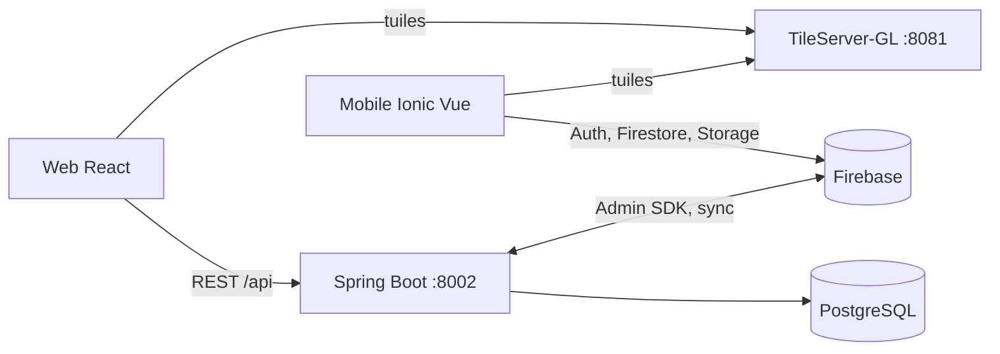

# Architecture

## Modules

| Module | Responsabilité |
|---|---|
| `cloud-back/.../controller` | Endpoints REST (`/api/auth`, `/api/admin`, `/api/users`, `/api/signalements`, `/api/photos`, `/api/entreprises`, `/api/configuration`, `/api/sync`, `/api/notifications`) |
| `.../service` | Règles métier : auth/sessions/verrouillage (`AuthService`), signalements et statuts (`SignalementService`), historique, sync Firebase (`FirebaseSyncService`), push FCM |
| `.../repository`, `.../entity` | Persistance JPA (PostgreSQL) |
| `.../config` | Filtre de session par jeton Bearer, Firebase, CORS |
| `web-react/src` | `pages/` (carte, signalements, utilisateurs, configuration), `services/api/` (appels HTTP), `contexts/AuthContext` |
| `mobile-vue/src` | `pages/`, `services/` (Firebase, cartes, signalements, notifications) |

## Flux principaux

1. **Connexion manager** : `POST /api/admin/login` → jeton de session (30 min) conservé en `sessionStorage`, envoyé en `Authorization: Bearer`.
2. **Changement de statut** : `PUT /api/signalements/{id}/status` → ligne d'historique + push FCM.
3. **Synchronisation** : `POST /api/sync/all` (PostgreSQL → Firestore, puis Firestore → PostgreSQL).

## Limite connue

L'API autorise actuellement toutes les requêtes (`SecurityConfig`) : les rôles ne sont pas appliqués. Voir `docs/ROADMAP.md`.
